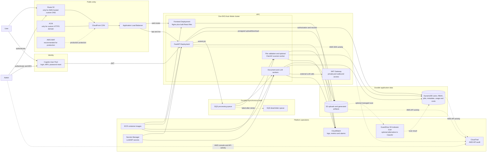

# Minimal AWS Service-Level Architecture

## Final service boundary

| Decision | Service | Reason |
|---|---|---|
| Keep | EKS Auto Mode | Runs frontend, API, scanner, and processing workers as separate Deployments in one cluster. Auto Mode manages the underlying node lifecycle. |
| Keep | ECR | Stores the immutable container images deployed to EKS. |
| Keep | ALB | Sends web routes to the frontend and API routes to FastAPI. |
| Keep | CloudFront | Caches the UI, provides one public entry point, and reduces direct ALB exposure. |
| Keep | S3 | Durable storage for uploads and generated files. It is not used to host the frontend in this selected design. |
| Keep | DynamoDB | Durable application state, RBAC, job progress, usage, and cost records. |
| Keep | SQS plus DLQ | Jobs survive pod restarts and deployments; workers can retry and scale independently. |
| Keep | Cognito | Passwords, MFA, reset flows, and tokens should not be implemented manually. Fine-grained RBAC remains application logic in DynamoDB. |
| Keep | Secrets Manager | Keeps the external LLM/API keys out of source code, images, and Kubernetes manifests. |
| Keep | CloudWatch | Runtime logs, metrics, alarms, and queue/worker visibility. |
| Keep | CloudTrail | Audits AWS API/configuration activity. Application user actions still go into DynamoDB audit records. |
| Keep | VPC | EKS and ALB require network/subnet boundaries. The VPC itself normally has no hourly charge. |
| Keep for private production nodes | NAT Gateway | EKS workers need controlled outbound internet access for the external LLM provider. It can be avoided only by giving nodes public internet paths, which is not recommended. |
| Conditional | Route 53 | Needed only if AWS hosts the product domain's DNS. Another DNS provider can be used. |
| Conditional | ACM | Needed for a custom HTTPS domain on CloudFront/ALB. The default CloudFront domain can be used during development. |
| Recommended for production | WAF | Edge rate limiting and common web-attack filtering. Application rate limits still remain in code. CloudFront flat-rate plans can include WAF. |
| Choose one | GuardDuty Malware Protection for S3 or ClamAV on EKS | Uploaded Office/PDF files are untrusted. GuardDuty is managed; ClamAV reduces AWS services but adds signature-update, scaling, and maintenance work. |
| Do not add initially | Customer-managed KMS | S3 and DynamoDB already encrypt data at rest with AWS-owned/service-managed keys. Add a customer-managed key only for a compliance or key-control requirement. |
| Do not model as application storage | EBS | EKS compute may use block/root storage internally, but durable application uploads and results remain only in S3 and DynamoDB. |

## EKS, EC2, and EBS clarification

EKS is the Kubernetes control plane and orchestrator; containers still require compute. In this design, **EKS Auto Mode** automatically provisions and operates the required EC2 managed instances, so the team does not manage EC2 node groups directly. AWS still bills the underlying compute. EBS may appear on the AWS bill for node/root or Kubernetes block storage, but the application must not rely on it for durable uploads or results.

The frontend and backend can remain in the same repository and the same EKS cluster, but use separate container images and Deployments. They do not need separate Git branches, and they should not share one pod because they scale and deploy independently.

## Authoritative references

- [EKS Auto Mode managed infrastructure](https://docs.aws.amazon.com/eks/latest/userguide/automode.html)
- [EKS ALB ingress requirements](https://docs.aws.amazon.com/eks/latest/userguide/alb-ingress.html)
- [EKS outbound internet access](https://docs.aws.amazon.com/eks/latest/userguide/external-snat.html)
- [SQS durability and decoupling](https://docs.aws.amazon.com/AWSSimpleQueueService/latest/SQSDeveloperGuide/welcome.html)
- [Cognito user pools](https://docs.aws.amazon.com/cognito/latest/developerguide/cognito-user-pools.html)
- [S3 default encryption](https://docs.aws.amazon.com/AmazonS3/latest/userguide/specifying-s3-encryption.html)
- [DynamoDB default encryption](https://docs.aws.amazon.com/amazondynamodb/latest/developerguide/EncryptionAtRest.html)
- [GuardDuty Malware Protection for S3](https://docs.aws.amazon.com/guardduty/latest/ug/gdu-malware-protection-s3.html)
