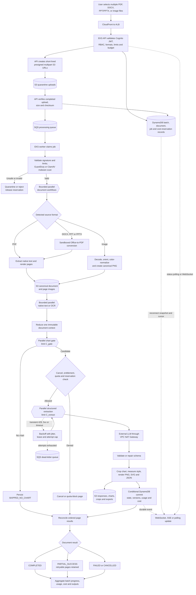

# Bulk Upload-to-Output Processing Flow



## Current application versus target

| Concern | Current code | Scalable target |
|---|---|---|
| Upload | One PDF plus images through FastAPI | Many independent documents uploaded directly to S3 |
| Formats | PDF, PNG, JPEG, WebP | Add DOCX and PPT/PPTX normalization |
| Durable work | `asyncio.create_task()` in the API pod | SQS/DLQ workers with job-stage logic in the worker code |
| State | Pod-local `manifest.json` | Conditional DynamoDB records and S3 artifacts |
| Page execution | Sequential gate then extraction | Bounded parallel screening and extraction |
| Context | Rolling notes force page order | Two-pass document context, then independent page calls |
| Events | In-memory replay queues | Durable progress snapshot/events, resumable after reconnect |
| Failure | Mostly whole-document error | Per-page retry plus partial document/batch success |
| Cancellation | In-memory task cancellation | Persistent cancel request checked before every costly stage |

The current loop intentionally carries `running_notes` from one page to the next, so only **one LLM call per document is in flight**. Several documents can still run at once without a global quota manager. The target removes the page dependency by building shared context first.

## LLM call count and concurrency

For `G` gated pages and `E` accepted pages, normal model calls are approximately:

```text
calls = G gate calls + E extraction calls
```

Parallelism reduces elapsed time; it does not reduce that call count. Retries, schema repair, reruns, or a final consistency pass add calls.

Safe initial tuning—not a permanent promise:

- Gate: up to 8 pages concurrently per document.
- Extraction: 2–4 pages concurrently per document.
- Active document workflows: 2–4 per tenant.
- Separate global pools for cheap gate calls and expensive extraction calls.

Calculate and continuously adjust the global limit:

```text
safe concurrency = min(
  configured provider cap,
  RPM * average latency seconds / 60,
  TPM * average latency seconds / (60 * average tokens per call),
  available worker slots
) * safety factor
```

Begin with a `0.7–0.8` safety factor. Apply weighted fair scheduling so one large batch cannot consume all capacity. Every dispatch is constrained by provider RPM/TPM, cluster capacity, tenant/user concurrency, and the remaining cost reservation.

## Durable state model

```text
Batch:
CREATED -> UPLOADING -> SUBMITTED -> PROCESSING
        -> COMPLETED | PARTIAL_SUCCESS | FAILED
        -> CANCEL_REQUESTED -> CANCELLED

Document:
REGISTERED -> UPLOADED -> VALIDATING -> SCANNING -> NORMALIZING
           -> CONTEXT_BUILDING -> SCREENING -> EXTRACTING -> FINALIZING
           -> COMPLETED | PARTIAL_SUCCESS | FAILED | QUARANTINED
           -> CANCEL_REQUESTED -> CANCELLED

Page:
PENDING -> READY -> GATING -> SKIPPED_NO_CHART
        -> QUEUED_FOR_EXTRACTION -> EXTRACTING -> POST_PROCESSING -> SUCCEEDED
        -> RETRY_WAIT -> FAILED_PERMANENT | CANCELLED
```

Every record includes tenant, user, batch, document, source/page ordinal, stage, algorithm/model version, attempt, timestamps, error code, usage, cost, and an optimistic revision number.

## Idempotency, retries, and cancellation

- Client idempotency key: `(tenantId, clientRequestId)`.
- Stage idempotency key: `(documentId, pageId, stage, algorithmVersion)`.
- Claim work using a conditional DynamoDB update and renewable lease.
- Write an attempt-specific S3 object, then conditionally commit the winning pointer.
- Duplicate SQS delivery or completion becomes a no-op; SQS is treated as at-least-once.
- Retry provider throttling, 5xx, and network timeouts with exponential backoff, full jitter, and `Retry-After`.
- Do not retry malicious, corrupt, unsupported, oversized, or unauthorized input.
- Preserve successful pages and send exhausted attempts to a DLQ with an alarm and replay procedure.
- Cancellation stops scheduling new work. Workers check durable cancellation before each model call. An already-running external request might still finish and be billed.
- Deletion is separate from cancellation and follows an audited retention workflow.

Exactly-once billing across an external LLM boundary cannot be guaranteed if a worker receives a response and crashes before saving it. Persist the response immediately, retain provider request IDs and attempts, and expose ambiguous retries to reconciliation rather than hiding them.

## Output contract

At completion, each document exposes:

- Original and normalized source metadata.
- Page statuses and summaries.
- Editable chart specs and immutable version history.
- Crops and rendered PNG/SVG/JSON artifacts.
- Confidence and validation warnings.
- Per-call and total usage/cost with pricing version.
- Failed/retryable pages and a partial-success indicator.
- Signed URLs only for outputs the user is authorized to view or download.

## Authoritative references

- [SQS visibility timeout](https://docs.aws.amazon.com/AWSSimpleQueueService/latest/SQSDeveloperGuide/sqs-visibility-timeout.html)
- [SQS dead-letter queues](https://docs.aws.amazon.com/AWSSimpleQueueService/latest/SQSDeveloperGuide/sqs-dead-letter-queues.html)
- [S3 multipart uploads](https://docs.aws.amazon.com/AmazonS3/latest/userguide/mpuoverview.html)
- [DynamoDB conditional and transactional operations](https://docs.aws.amazon.com/amazondynamodb/latest/developerguide/transaction-apis.html)
- [DynamoDB constraints](https://docs.aws.amazon.com/amazondynamodb/latest/developerguide/Constraints.html)
